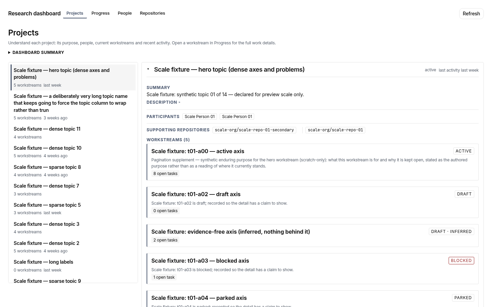
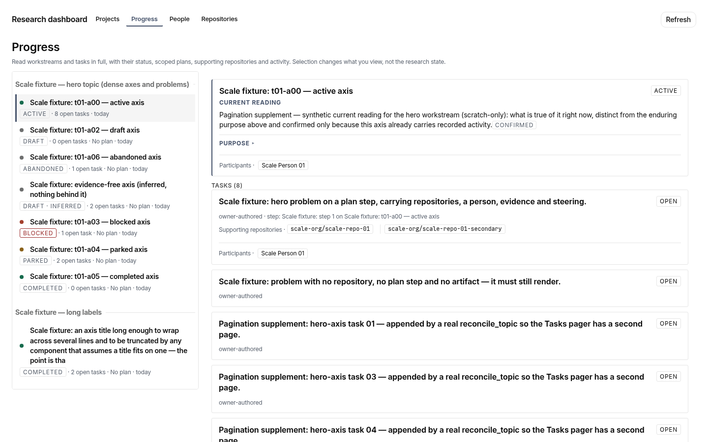
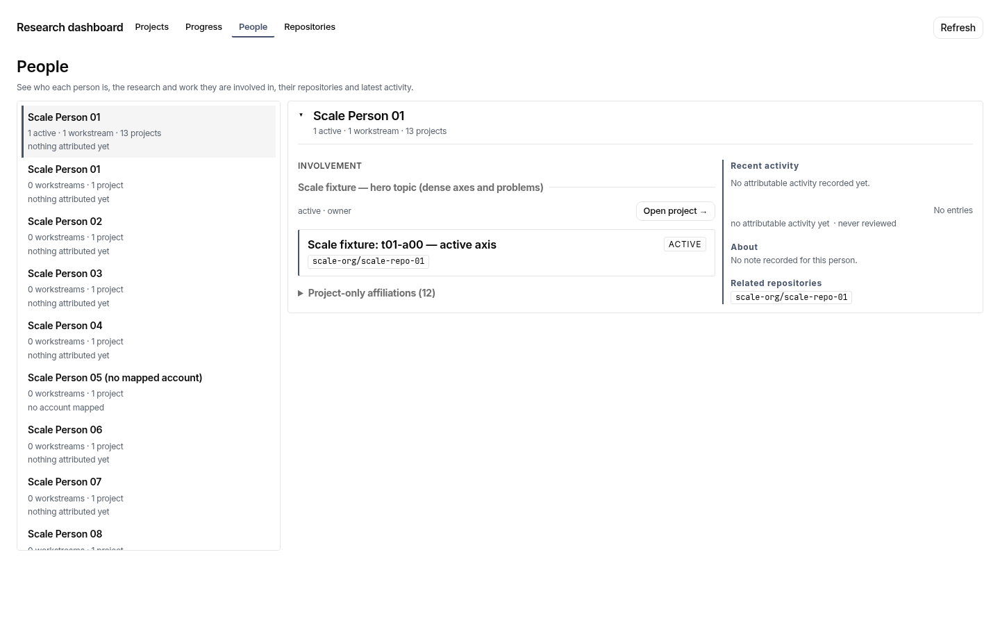
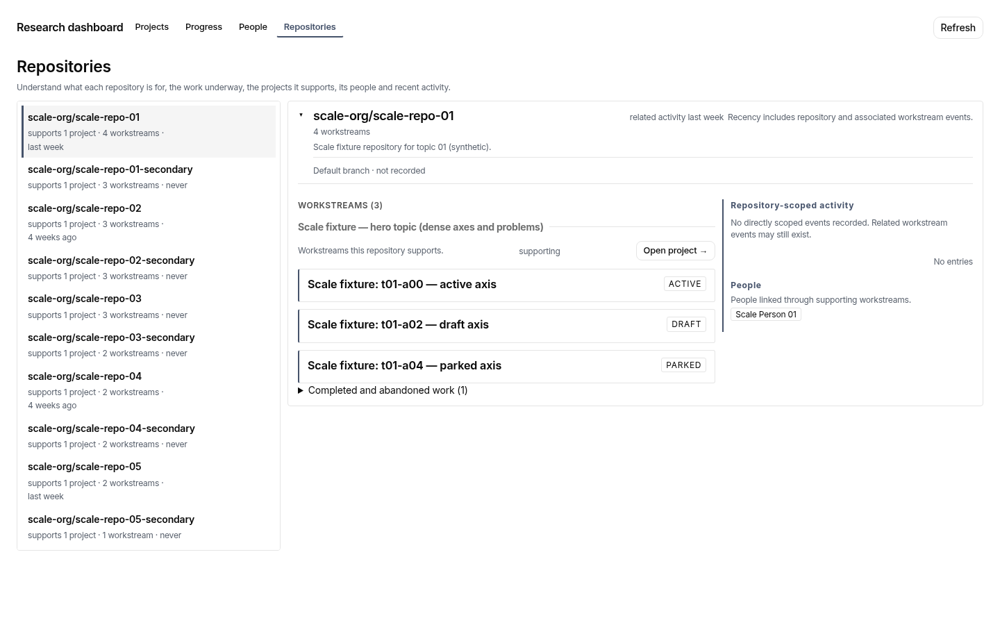
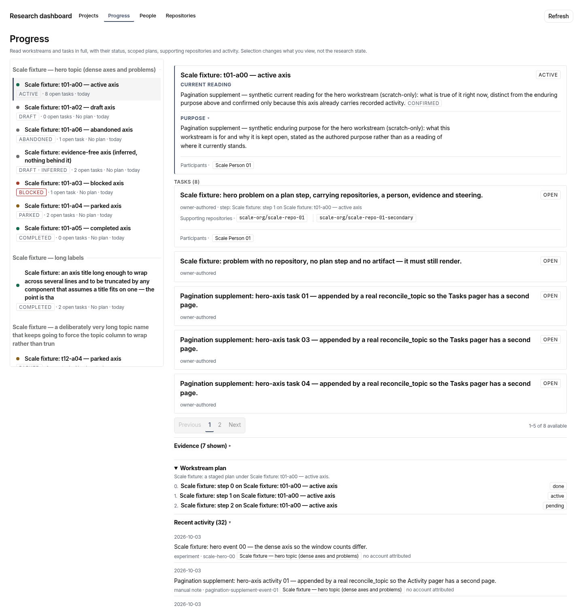
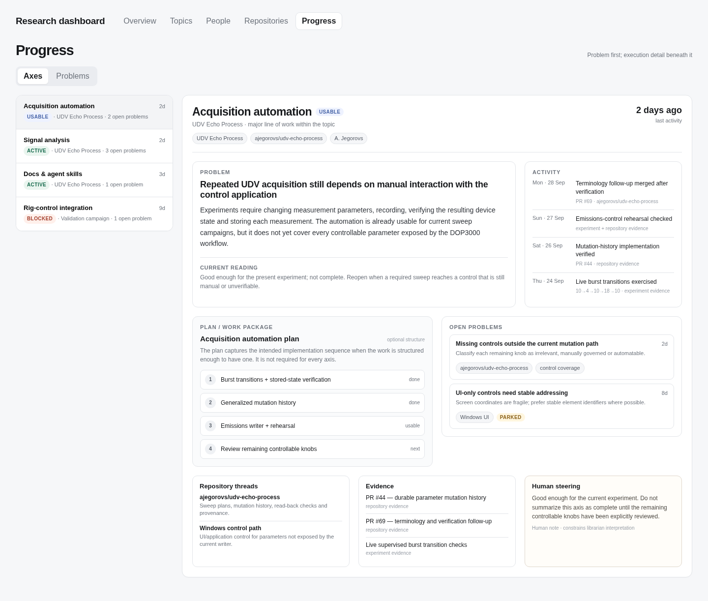

# Screenshot gallery

## Current UI — synthetic preview baseline

These representative captures show the implemented four-view UI, not an installed production instance. Source commit: `bdd349875c08218b40db0a1cf83b5f88d0d5d3a5`. Dataset: existing **synthetic scale-pagination supplement**. Light theme; no live research data or browser writes. They document the current baseline for [visual information-design research](../design/visual-information-design.md), not approval of a new design.

The [manifest](current-preview/manifest.json) records bundle identity, raw image digests and image dimensions. Views use populated representative selections, not necessarily the application's initial selection. Progress selects `Scale fixture: t01-a00 — active axis`; other views select the hero project, involved Scale Person 01, and `scale-org/scale-repo-01`. Sparse attributed activity in People/Repositories is a dataset boundary. Synthetic long labels intentionally stress the layout.

### Projects

### Progress — default disclosures

### People

### Repositories

### Progress — supporting structure revealed

Purpose, workstream plan and recent activity opened through their real disclosure controls. This is a **1440×1500 viewport**, not a standard desktop screenshot; content below that viewport is not claimed visible.

### Smaller desktop viewport

- [Projects — 1280×800](current-preview/projects-1280x800.png)
- [Progress — 1280×800](current-preview/progress-1280x800.png)
- [People — 1280×800](current-preview/people-1280x800.png)
- [Repositories — 1280×800](current-preview/repositories-1280x800.png)

## Historical Progress prototype — comparison reference

Captured from [the retained standalone HTML](../ux-v2/contract/prototypes/progress.html) at 1440px width, full page (1440×1222). This uses different curated content, older terminology and an older composition. It is **not a same-data before/after comparison**, current product contract or served acceptance record.

## Historical screenshot packs

Other images directly under this directory and `1280x800/` are retained historical build evidence. They are not current product screenshots. They were not overwritten or relabelled by this refresh. The compact current-preview set above is the entry point for current visual discussion; it is intentionally committed under the owner's screenshot-refresh instruction. Scratch campaign output, tall captures and raw operational reports remain uncommitted.
